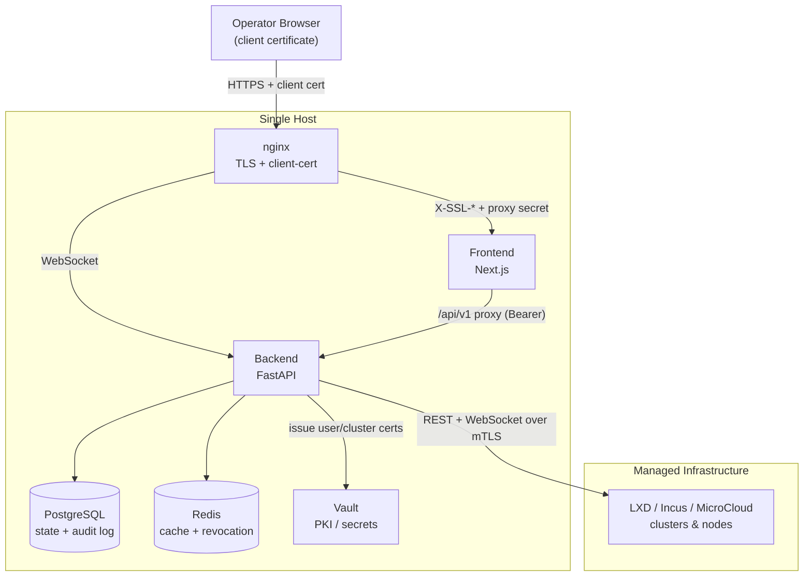

# Orcastra Dashboard - Mini (orcastra-mini)

[](https://github.com/sctsivali/orcastra-dashboard/releases/tag/v1.0.0-RC1)
[](https://github.com/sctsivali/orcastra-dashboard/releases)
[](LICENSE)
[](https://discourse.orca.id)
[](https://docs.orcastra.io)

A single-host build of the Orcastra Dashboard for managing LXD/Incus hypervisors. It runs the
control plane and HashiCorp Vault on one machine and authenticates operators with TLS client
certificates, so there is no separate identity provider and no external log cluster to operate.
The full 3-tier RBAC, instance lifecycle, console/terminal, and monitoring are all kept.

This branch (`orcastra-mini`) is the mini profile of the same codebase as the mainline
Orcastra Dashboard. The Authentik and OpenSearch integrations are not removed, only switched
off behind feature flags, so a site can move to the full multi-host topology later without a
rewrite.

## Mini vs Full

| Concern | Mini (this branch) | Full (mainline) |
|---------|-----------------------|-----------------|
| Hosts | One (Dashboard + Vault) | Up to four (Dashboard, Authentik, Vault, OpenSearch) |
| Operator auth | TLS client certificate (trust-on-first-use) | Authentik OAuth2/OIDC SSO |
| Audit log | Append-only, hash-chained PostgreSQL table | Fluent Bit to OpenSearch |
| Central logging | None (stdout + Postgres audit) | OpenSearch + dashboards |
| Public surface | One HTTPS port via nginx (mTLS) | Frontend/backend per the full topology |
| Best for | Edge sites, single-tenant labs, air-gapped or small deployments | Multi-org, multi-region, centralized compliance |

Switch is by `AUTH_MODE`: `client-cert` selects this profile, `authentik` is the full version.

## Stack

| Layer | Technology |
|-------|-----------|
| **Backend** | FastAPI, Python 3.11+, SQLAlchemy (async), Alembic |
| **Frontend** | Next.js 15, React 18, TailwindCSS, Radix UI |
| **Database** | PostgreSQL 17 (application state + audit log) |
| **Cache** | Redis 8 (LRU eviction, session revocation flags) |
| **Auth** | TLS client certificates, NextAuth.js 5 (Credentials), minted HS256 JWT |
| **Secrets / PKI** | HashiCorp Vault (issues user and cluster certificates) |
| **Edge** | nginx (TLS termination + client-cert request, single public port) |
| **Deployment** | Docker Compose (`docker-compose.mini.yml`) |

## Features

### Certificate authentication
- TLS client-certificate login with trust-on-first-use enrollment, like the LXD/Incus UI.
- The first certificate enrolls as Admin through a one-time bootstrap token; the Admin then
  issues Partner and Tenant certificates from the UI.
- Identity is the SHA-256 fingerprint of the presented certificate, recomputed server-side; the
  role is read from the local identity store, never from the certificate subject.
- Certificates are issued by Vault PKI as password-protected `.p12` bundles, downloaded once,
  with the import password delivered out of band.
- Revocation and role changes take effect on the next request (Redis-backed), independent of
  the certificate's own validity window.

### Virtualization management
- Multi-node LXD/Incus/MicroCloud support.
- Instance lifecycle for containers and VMs (create, start, stop, restart, delete).
- Images, projects, profiles, storage pools and volumes, virtual networks with ACLs and IPAM.

### Interactive console and terminal
- Terminal over WebSocket (xterm.js) and SPICE graphics console.
- Per-instance tenant ACL enforced before the upstream connection opens.
- A live session drops within about a minute if the operator's certificate is revoked.

### Access control
- 3-tier RBAC (Admin / Partner / Tenant) with per-resource permissions.
- Tenant access policies scoped by cluster, project, and instance.
- No default-grant: an identity that maps to no role is denied, never silently treated as a tenant.

### Audit and monitoring
- Append-only, hash-chained audit log in PostgreSQL: each row links to its predecessor, so
  in-place edits and reordering are tamper-evident, and `/audit-log/verify` also detects tail
  truncation against a stored high-water mark.
- Security-critical events (login, certificate issue/revoke, key operations) are written
  synchronously and fail closed.
- Real-time CPU, memory, disk, and network metrics over WebSocket, with history in PostgreSQL.
- In-app audit viewer with date-range filter and server-side sorting.

## Prerequisites

- Docker with the Compose plugin.
- LXD/Incus/MicroCloud nodes with the API enabled (to manage real infrastructure).
- A TLS server certificate for nginx (self-signed is fine for a single host).
- No Authentik and no OpenSearch are required for this profile.

## Architecture

The browser connects to nginx over HTTPS and presents its client certificate. nginx terminates
TLS, requests the certificate (`ssl_verify_client optional_no_ca`, trust-on-first-use), and
forwards the verified certificate to the Next.js frontend, which exchanges it at the backend for
a short-lived session token. The backend keeps state in PostgreSQL, caches in Redis, issues
certificates from Vault, and drives the managed LXD/Incus clusters over mTLS. Only nginx is
published to the host; the frontend and backend are reachable only on the Docker network.



### Ports

| Service | Port | Exposure |
|---------|------|----------|
| nginx (HTTPS) | `6969` | Published to the host (the only public port) |
| Frontend | `2025` | Docker network only |
| Backend | `4050` | Docker network only |
| Vault | `8200` | Loopback only (`127.0.0.1`) |

The single public port is set with `HTTPS_PORT` in `.env`.

## Security model

- nginx overwrites the `X-SSL-*` headers from the real TLS layer, so a browser cannot forge
  them. The backend accepts those headers only when a shared proxy secret matches and the caller
  is in the trusted proxy CIDR; the generic API proxy strips them entirely.
- The backend port is never published to the host, so cert headers cannot be injected directly.
- The bootstrap of the first admin is one-shot, single-winner, constant-time, and the token is
  never logged.
- Minted session tokens are HS256 with a dedicated secret and distinct issuer/audience, so they
  cannot be confused with full-version (RS256) tokens.
- Downloaded `.p12` bundles are encrypted with a one-time password and never cached.

## Quick start

```bash
# 1. Clone and switch to this branch
git clone -b orcastra-mini https://github.com/sctsivali/orcastra-dashboard.git
cd orcastra-dashboard

# 2. Configure
cp .env.example .env
# In .env set at least: AUTH_MODE=client-cert, HTTPS_PORT=6969,
#   POSTGRES_PASSWORD, SECRET_KEY, LOCAL_JWT_SECRET, AUTH_PROXY_SECRET,
#   BOOTSTRAP_ADMIN_TOKEN, NEXTAUTH_URL/NEXT_PUBLIC_API_URL/CORS_ORIGINS (https://<host>:6969)

# 3. Provide the nginx TLS server certificate (self-signed example)
mkdir -p config/nginx/certs
openssl req -x509 -newkey rsa:2048 -nodes -days 825 \
  -keyout config/nginx/certs/server.key -out config/nginx/certs/server.crt \
  -subj "/CN=<host-or-ip>" -addext "subjectAltName=IP:<host-ip>"

# 4. Build and start the mini stack
make up-mini

# 5. Initialise and unseal Vault, then enable PKI (one time)
#    See the operator runbook for the exact init/unseal and pki_int steps.

# 6. Enroll the first admin with the bootstrap token, then issue Partner/Tenant
#    certificates from the Administration menu and import the .p12 into the browser.

# Open https://<host>:6969 and sign in with the imported certificate.
```

Vault uses manual unseal by design; it must be unsealed after every restart.

## Make commands

```bash
make up-mini       # build and start the mini (client-cert) stack
make down-mini     # stop the mini stack
make logs-mini     # tail mini stack logs
make ps-mini       # list mini stack containers
make config-mini   # validate docker-compose.mini.yml
```

The general targets (`make build`, `make version`, and so on) also apply; the `-mini` targets
simply point at `docker-compose.mini.yml`.

## Configuration

Copy `.env.example` to `.env`. The settings specific to this profile:

```bash
# profile
AUTH_MODE=client-cert            # selects certificate auth (authentik = full version)
HTTPS_PORT=6969                  # the single public HTTPS port (nginx)

# session tokens (client-cert mode)
LOCAL_JWT_SECRET=                # openssl rand -hex 32 (must differ from SECRET_KEY)
LOCAL_JWT_TTL_SECONDS=3600       # access-token lifetime; revocation is per-request

# trust boundary (nginx -> backend)
AUTH_PROXY_SECRET=               # shared secret nginx injects; backend requires it
TRUSTED_AUTH_PROXY_CIDRS=        # optional: restrict cert-header acceptance to the proxy peer

# first-admin enrollment (trust-on-first-use)
BOOTSTRAP_ADMIN_TOKEN=           # one-time token; blank it again after the first admin exists

# audit
AUDIT_DB_ENABLED=true            # persist the hash-chained audit log to PostgreSQL

# core (shared with the full version)
POSTGRES_PASSWORD=               # database password
SECRET_KEY=                      # openssl rand -hex 32
VAULT_ENABLED=true
VAULT_ADDR=http://vault:8200
VAULT_TOKEN=                      # Vault token for PKI issuance
NEXTAUTH_URL=https://<host>:6969
NEXT_PUBLIC_API_URL=https://<host>:6969
CORS_ORIGINS=https://<host>:6969
```

`AUTHENTIK_*` and `OPENSEARCH_*` are left unset in this profile; the related code paths stay
disabled behind their feature flags.

## Switching to the full version

Set `AUTH_MODE=authentik`, provide the `AUTHENTIK_*` settings, optionally enable the OpenSearch
archive, and deploy with the mainline `docker-compose.yml`. The data model is shared, so the same
database carries over. See [docs.orcastra.io](https://docs.orcastra.io) for the multi-host topology.

## API endpoints

<details>
<summary>Show API endpoints</summary>

Most endpoints are prefixed with `/api/v1`; the health check is served at the root. Endpoints
specific to this profile:

- `/auth/cert-login`, `/auth/cert-bootstrap` - certificate exchange and first-admin enrollment
- `/local-identities` - admin certificate issuance, role change, revoke (mini identity store)
- `/audit-log`, `/audit-log/verify` - audit viewer and chain integrity check

Shared with the full version: `/instances`, `/vms`, `/images`, `/projects`, `/profiles`,
`/networks`, `/network-acls`, `/storage/pools`, `/storage/volumes`, `/nodes`, `/clusters`,
`/certificates`, `/terminal`, `/console`, `/file-transfer`, `/monitoring`, `/regions`,
`/warnings`, `/operations`, `/server`, `/tags`, `/my-keys`, `/user-preferences`,
`/organizations`, `/tenant-access`, `/system`, `/ipam`.

See `/docs` for interactive Swagger documentation.

</details>

## Versioning

The project follows [Semantic Versioning](https://semver.org/). `RC` marks a release candidate
for testing before a stable release. The version is centralized in `APP_VERSION` (`.env`) and the
frontend `package.json`, and propagates to all components at build time.

## Key resources

- License: GNU GPL v3 ([LICENSE](LICENSE))
- Contribution workflow: [CONTRIBUTING.md](CONTRIBUTING.md)
- Community standards: [CODE_OF_CONDUCT.md](CODE_OF_CONDUCT.md)
- Security disclosure: [SECURITY.md](SECURITY.md)
- Support channels: [SUPPORT.md](SUPPORT.md)
- Product and deployment docs: https://docs.orcastra.io
- Community forum: https://discourse.orca.id
