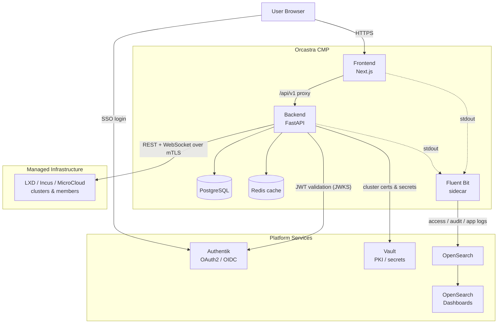

```
   ____                       __
  / __ \______________ ______/ /__________ _
 / / / / ___/ ___/ __ `/ ___/ __/ ___/ __ `/
/ /_/ / /  / /__/ /_/ (__  ) /_/ /  / /_/ /
\____/_/   \___/\__,_/____/\__/_/   \__,_/

Open Reliable Cloud Access and Orchestration
```

# Orcastra CMP

[](https://github.com/sctsivali/orcastra-cmp/releases/tag/v1.0.1)
[](https://github.com/sctsivali/orcastra-cmp/releases)
[](LICENSE)
[](https://discourse.orca.id)
[](https://docs.orcastra.io)

Control plane for LXD and Incus clusters across many organizations. It registers clusters,
runs the instance lifecycle, moves workloads between projects, members and clusters, gives
browser terminals and graphical consoles, and keeps access, audit and logging in one place.

## Stack

| Layer | Technology |
|-------|-----------|
| **Backend** | FastAPI, Python 3.12, SQLAlchemy 2 (async), Pydantic 2, Alembic, pylxd |
| **Frontend** | Next.js 15.5, React 18, Tailwind CSS 3, Radix UI, TanStack Query, xterm.js, Leaflet |
| **Database** | PostgreSQL 17 |
| **Cache** | Redis 8 (LRU eviction, Fernet-encrypted values, monitoring history) |
| **Auth** | Authentik (OAuth2/OIDC), NextAuth.js 5, JWT validated against JWKS |
| **Secrets** | HashiCorp Vault (PKI for cluster client certificates, KV) |
| **Logging** | Fluent Bit -> OpenSearch (centralized log aggregation) |
| **Deployment** | Docker Compose (dev + prod) |

## Features

A cluster here is one registered LXD or Incus endpoint, either a standalone server or a
clustered set of machines. Each machine of a clustered one is a cluster member.

### Virtualization Management
- LXD, Incus and MicroCloud clusters, standalone or clustered
- Containers and VMs are created, started, stopped, restarted, deleted, rebuilt (the root disk is
  reinstalled while identity, config and volumes stay) and resized after a preflight check
- Snapshots per instance and on a fleet Snapshots page. A restore can take a safety snapshot
  first, and on ZFS the restore is planned before anything is written. Recurring snapshot
  schedules are opt-in (`SNAPSHOT_SCHEDULES_ENABLED`)
- Migration Center copies or moves instances between projects, members and clusters, or relocates
  a whole project with its profiles. A moved source is kept and fenced for 24 hours by default,
  with Finalize and Roll back
- Images and ISOs can be imported or uploaded, and an ISO attached or ejected from the console
- Projects, profiles, storage pools and volumes, bridge and OVN networks, network ACLs and IPAM

### Interactive Console & Terminal
- Browser terminal over WebSocket (xterm.js) and a graphical console for VMs
- Sessions page with active and past sessions, bandwidth, and kill all
- Drag-and-drop file upload to instances, live resource overlay while a console runs
- Break-glass gives an Admin a time-limited grant (60 minutes by default, 240 at most) to a
  tenant's console or terminal, listed with its own audit trail
- Per-organization consent before an agent may drive a guest desktop

### Security & Access Control
- OAuth2/OIDC sign-in through Authentik. The backend validates JWTs against the IdP's JWKS and
  keeps the last good keys through a short IdP outage (`AUTH_JWKS_MAX_STALE`)
- Three-tier RBAC (Admin, Partner, Tenant) from Authentik groups. The baseline `role_tenant` group
  is preserved during Partner promotion and organization offboarding, and organization membership
  still governs resource access. Admin removal explicitly revokes roles and reports a failed
  Authentik write. Role API calls verify the Authentik TLS certificate
- An account with no role, or with no cluster access, sees an access notice instead of an empty
  console
- Fine-grained per-resource permissions and tenant access policies (cluster, project, instance)
- WebSockets open with single-use tickets, and tokens in WebSocket URLs are refused
- A sealed or unreachable Vault is reported on every page instead of reading as "no clusters"
- `READ_ONLY_MODE` for maintenance windows and demos, rate limiting, encrypted Redis cache,
  HMAC-SHA256 API keys
- Profile in the user menu opens the account settings of the deployment's own Authentik

### Multi-Cluster & Region Management
- Vault-backed cluster registry. The dashboard issues each cluster's client certificate from Vault
  PKI at registration and prints the `lxc` or `incus` trust command to run
- Certificate renewal and regeneration started by an operator, with a pending state until the
  cluster trusts the new certificate. Fingerprints are shown the way LXD shows them, and trust
  entries of replaced certificates are removed once the new one is proven
- Cluster health with a circuit breaker, so an unreachable cluster answers quickly as unreachable
  instead of stalling every list
- Kernel CVE advisories per cluster member (Partner and above), as a chip on cluster cards and a
  Kernel CVEs tab under Warnings
- Regions map from a bundled offline basemap (no outbound request), with region, zone,
  facility and hardware details. A cluster abroad shades its whole country

### Monitoring & Observability
- Real-time CPU, memory, disk and network metrics over WebSocket, with chart history in Redis and
  PostgreSQL snapshots
- Task dock on every console page with live tasks, the queue and the cluster log, plus an
  Operations page for LXD operations
- Warnings page with LXD warnings, expiring certificates, offline clusters and kernel CVE findings
- Activity audit log with action, result and user

### Logging & Compliance
- Fluent Bit sidecar forwarding container logs to OpenSearch
- OpenSearch Dashboards for access, audit, Vault audit, containers and overview
- Log archive with ISM policies and snapshot scheduling, opt-in (`OPENSEARCH_ARCHIVE_ENABLED`)

### Personalization & Branding
- Per-user theme (light, dark, system) synced to the database
- Accent colour, sidebar style and logo (light and dark), with undo and redo
- Organization branding for the app name, tagline and footer

### Integration & External APIs
- API keys with capabilities, project scope, per-key rate limits and in-place secret rotation.
  Grants are bound to the cluster registration and each key's use is recorded
- MCP server at `/api/v1/mcp` for AI agents, authenticated with API keys, with tool tiers,
  a method allow-list, per-key rate limits and an audit record per call
- Add-ons come from a registry and install with consent to capabilities and scope, with signed
  webhooks and a delivery log, credential rotation, and a curated add-on API document
- OrcaHub integration covers organization sync, tenant provisioning and lifecycle webhooks, with
  each synced organization owned by API keys an admin can transfer
  ([partner SSO through OrcaHub](https://docs.orcastra.io/en/latest/operations/orcahub-federation-sso/))
- Raw HTTP proxy to LXD for third-party tools

## Prerequisites

- Docker Engine 24+ with the Compose plugin 2.20+
- Authentik with the `role_admin`, `role_partner` and `role_tenant` groups and an API token
- HashiCorp Vault with a PKI role and a KV path for cluster certificates
- LXD or Incus (MicroCloud included) with its HTTPS API reachable from the dashboard, and shell
  access to run the trust command the dashboard prints at registration
- OpenSearch (optional, for centralized logging)

The full multi-host install is described at [docs.orcastra.io](https://docs.orcastra.io).

## Architecture

The browser loads a Next.js frontend, which proxies API calls to a FastAPI backend. The backend keeps
state in PostgreSQL, caches LXD responses in Redis, validates tokens against Authentik, and reads
cluster certificates and secrets from Vault. It drives the managed LXD/Incus clusters over mTLS.
Container logs are shipped to OpenSearch by a Fluent Bit sidecar that tails Docker stdout, so Redis is
not part of the logging path.



Authentik, Vault, and OpenSearch run as separate hosts in production. See
[docs.orcastra.io](https://docs.orcastra.io) for the full multi-host (4-VM) deployment topology and
the detailed logging pipeline.

### Ports

| Environment | Frontend | Backend |
|-------------|----------|---------|
| Development | 2025 | 4050 |
| Production  | 4321 | 8765 |

## API

The backend serves its API under `/api/v1`, and `/health` at the root. The add-on API that API
keys may call is described at `/api/v1/docs/public` (OpenAPI at `/api/v1/openapi.public.json`).
The full interactive Swagger UI at `/docs` is served only when `DEBUG=true`.

## Quick Start

```bash
git clone https://github.com/sctsivali/orcastra-cmp.git
cd orcastra-cmp
cp .env.example .env    # fill every [REQUIRED] block: Vault, Authentik, database, secrets
make build
make up
make health
```

## Make Commands

```bash
make help            # every target with a one-line description
make health          # check service health
make logs            # follow all logs
make test-backend    # pytest, needs no database or cluster
make test-frontend   # typecheck + structural guards
```

The rest is in [MAKEFILE_QUICK_REF.md](MAKEFILE_QUICK_REF.md).

## Configuration

Copy `.env.example` to `.env`. Each variable is documented in place. Production values and the
order to set them in are in the
[dashboard deployment guide](https://docs.orcastra.io/en/latest/deployment/vm4-dashboard/), and
the optional Regions map tile provider in
[Regions map basemap](https://docs.orcastra.io/en/latest/operations/regions-basemap/).

## Key Resources

- Licensed under the GNU GPL v3, see [LICENSE](LICENSE)
- Contribution workflow and versioning in [CONTRIBUTING.md](CONTRIBUTING.md)
- Community standards in [CODE_OF_CONDUCT.md](CODE_OF_CONDUCT.md)
- Security disclosure in [SECURITY.md](SECURITY.md)
- Support channels in [SUPPORT.md](SUPPORT.md)
- Product and deployment docs at [docs.orcastra.io](https://docs.orcastra.io)
- Community forum at [discourse.orca.id](https://discourse.orca.id)
