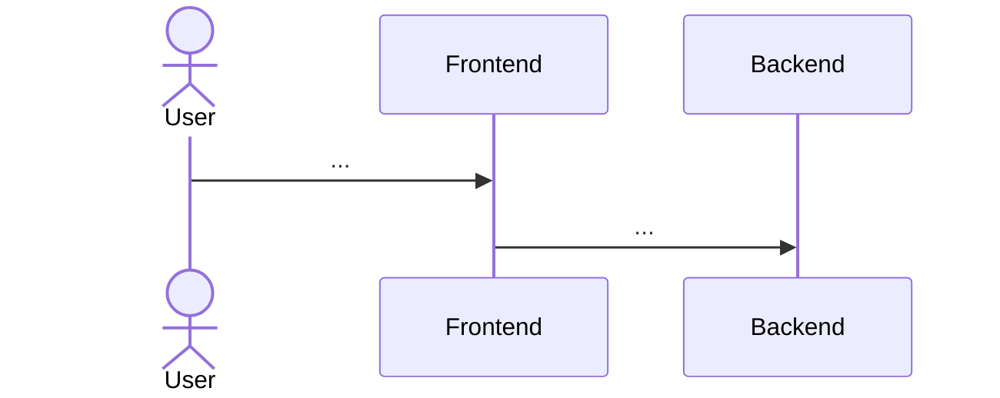

<!--
  FEATURE DOCUMENT TEMPLATE (lean-adaptive).
  Copy this file to documentation/<domain>/<feature>.md and fill it in.
  - CORE sections (marked [core]) are always present.
  - OPTIONAL sections (marked [optional]) appear only when relevant. Delete the ones that do not apply rather than writing "N/A".
  - Replace every <placeholder>. Cite real code as `path:line`. Keep it specific to Orcastra.
  - Follow the house writing style in README.md section 7: plain prose, real subheadings/tables, no bold-label-colon, no filler, no marketing words, hyphens not em-dashes.
-->
---
title: <Feature name>
status: Draft            # Draft | Active | Deprecated | Superseded
owner: <name or team>
domain: <clusters | instances | networking | storage | auth | rbac | observability>
version: 1.0.0
created: <YYYY-MM-DD>
updated: <YYYY-MM-DD>
audience: <engineers | operators | both>
related:                 # context links; omit empty entries
  - PR or commit: <sha or link>
  - ADR: <adr/NNNN-...>
---

# <Feature name>

## Summary  <!-- [core] -->
<One short paragraph: what this is and the value it delivers. A reader should understand it in ten seconds.>

## Problem & Motivation  <!-- [core] -->
<Why this exists. What was missing or broken before. The user or operator need.>

## Scope  <!-- [core] -->

### In scope
<What this feature does.>

### Out of scope
<Explicit non-goals, to head off misunderstanding and scope creep.>

## How It Works  <!-- [core] -->
<The design and the end-to-end flow. Name the real entry points and modules as `path:line` (router -> service -> LXD/DB, or component -> hook -> api client). Add a Mermaid diagram for a non-trivial cross-service flow.>

## Data Model & Migrations  <!-- [optional: include if the DB changed] -->
<SQLAlchemy models or fields added or changed, enums, indexes. The Alembic migration revision and whether it is applied. Any backfill.>

## API / Interface  <!-- [optional: include if endpoints or contracts changed] -->
<Routes (method and path), request and response shape, Pydantic validation, error codes. Cite the router file.>

## RBAC & Role Behavior  <!-- [core] -->
<How each role experiences the feature, and the gating.>

### Admin
<Behavior and access.>

### Partner
<Behavior and access.>

### Tenant
<Behavior and access.>

### Gating and redirects
<Which dependency or middleware enforces it, and where an unauthorized user lands.>

## Configuration / Env / Vault  <!-- [core] -->
<Every env var, Vault path, and flag that controls this feature, each with its default and what changing it does. If the feature ships inert, say so and point to the go-live steps in the runbook.>

| Name | Default | Effect |
|------|---------|--------|
| `<ENV_OR_FLAG>` | `<default>` | <what it does> |

## Security & Privacy  <!-- [core] -->
<Authorization boundaries and how they are enforced. IDOR and tenant or cluster isolation. Secret and certificate handling (Vault, JWT, API keys). PII touched, and how it is protected and retained.>

## Operational / Runbook  <!-- [optional: include if there is anything to deploy or operate] -->
<Deployment and rollout. Alembic migration order. Rollback. Monitoring and alerts to watch. Any cluster registration, certificate, or Vault steps. For an inert feature, the exact go-live checklist.>

## Testing & QA Evidence  <!-- [core] -->
<What is covered and how to run it. Cite the test files. Include the QA actually performed against the running stack and the relevant roles. This is the proof the feature works.>

- Backend: <pytest files or command>
- Real run and per-role UI: <Admin / Partner / Tenant scenarios run, and the result>

## Usage / How-To  <!-- [optional: include if there is a user or operator workflow] -->
<Concrete steps to use the feature, from the relevant perspective.>

## Known Limitations & Future Work  <!-- [core] -->
<Current limits, sharp edges, and deferred phases. Be honest.>

## Revision History  <!-- [core] -->
| Date | Version | Change | Author |
|------|---------|--------|--------|
| <YYYY-MM-DD> | 1.0.0 | Initial document. | <name> |
